# PASSWORD CRACKING WITH JTR & NETWORKWALKS TOOLS

**Week 3 Project Report | Cybersecurity & Ethical Hacking | Networkwalks**

| Field | Detail |
| --- | --- |
| **Intern Name** | Emmanuel Afunanya |
| **Program/Batch** | B084 - Networkwalks |
| **Date** | 20 November 2026 |
| **Modules completed** | W3-PM1 (Password Cracking with JTR), W3-PM2 (Password Cracking with Networkwalks Tools) |
| **Target files** | Lab-provided locked PDF files, supplied for this training exercise only |
| **Permission secured?** | Yes - all files were provided by Networkwalks for this lab |

---

## 1. Liability Disclaimer

All activity in this report was performed only on files provided by Networkwalks for this training lab. This exercise is for education and research purposes only. The goal is to understand how weak passwords fail under testing, so stronger passwords can be recommended. No real system, account or third-party file was accessed. Do not use anything from this report to access data or systems you do not own or have written permission to test.

---

## 2. Introduction

This report covers Week 3 of my Cybersecurity & Ethical Hacking internship at Networkwalks: **password security testing** using password recovery/cracking techniques.

A locked file does not store its password directly. Instead, it stores a **hash**, a scrambled value derived from the password. To recover the password, a hash is first extracted from the file, then a cracking tool tries candidate passwords, hashes each one the same way, and checks for a match. This report walks through that process using two different approaches on the same type of file, plus bonus practice on additional lab files.

---

## 3. Tools Used

| Tool | Purpose |
| --- | --- |
| Online PDF Hash Extractor | Extract a crackable hash from a password-protected PDF |
| John the Ripper (JtR) | Industry-standard offline password recovery tool |
| Johnny | Graphical interface for John the Ripper |
| Networkwalks Hash Calculator | Browser-based tool to extract a PDF's hash |
| Networkwalks Password Cracker | Browser-based dictionary attack tool |
| Notepad | Used to save extracted hash values correctly |

---

## 4. Activities Performed

### 4.1 W3-PM1: Password Cracking with John the Ripper (JtR)

**Step 1 - Extract the hash.** The locked PDF was uploaded to an online PDF hash extractor, which read the file's encryption data and returned a crackable hash starting with `$pdf$...`. The hash was copied in full and saved to a text file, with any stray characters (such as a leading `b'`) removed so the file began exactly with `$pdf$`.

**Step 2 - Set up the tools.** John the Ripper (jumbo build) and Johnny were downloaded and installed on Windows. In Johnny's Settings, the path to `john.exe` was set so Johnny could drive John the Ripper directly.

**Step 3 - Load and crack.** The saved hash file was opened in Johnny via "Open password file". The attack was started, and John the Ripper tried candidate passwords against the hash until it found a match.

**Result:** Password recovered: **`password1`**

**Step 4 - Verify.** The recovered password was used to open the originally locked PDF, confirming the file unlocked successfully and the first flag was captured.

**Evidence:** `screenshots/pm1-hash-extractor.png`, `screenshots/pm1-johnny-cracked.png`, `screenshots/pm1-pdf-password-entry.png`, `screenshots/pm1-pdf-unlocked.png`

### 4.2 W3-PM2: Password Cracking with Networkwalks Tools

This module repeats the same exercise using Networkwalks' own browser-based tools, with no installation required.

**Step 1 - Extract the hash.** The same locked PDF was uploaded to the Networkwalks **Hash Calculator** (`networkwalks.com/hash-calculator`). The tool parsed the PDF locally in the browser and returned the same type of crackable hash, starting with `$pdf$...`.

**Step 2 - Crack the hash.** The hash was copied and pasted into the Networkwalks **Password Cracker** (`networkwalks.com/password-cracker`), a dictionary attack tool that works on the same principle as John the Ripper: it hashes each word in a wordlist and compares it to the target hash.

**Result:** Password recovered: **`password1`** (matching the JtR result, confirming both methods are consistent)

**Step 3 - Verify.** The recovered password successfully opened the PDF.

**Evidence:** `screenshots/pm2-hash-calculator.png`, `screenshots/pm2-password-cracker-result.png`, `screenshots/pm2-pdf-unlocked.png`

### 4.3 Bonus: Additional Practice Files

Beyond the two required modules, I located and cracked additional lab-provided locked files to reinforce what I learned. Each followed the same hash-extraction-then-crack process described above.

| File | Password recovered | Flag captured |
| --- | --- | --- |
| Bonus PDF (extra file) | (recovered via JtR) | nw{cybersecurity_flag_captured_2608} |
| Bonus PDF (file 2) | good-luck | nw{networkwalks_persistence_jtr_270521} |
| Bonus PDF (file 3) | (recovered via JtR) | nw{networkwalks_flag_260821_1} |

**Evidence:** `screenshots/bonus-pdf-extra-password-entry.png`, `screenshots/bonus-pdf-extra-unlocked.png`, `screenshots/bonus-johnny-cracked.png`, `screenshots/bonus-pdf2-password-entry.png`, `screenshots/bonus-pdf2-unlocked.png`, `screenshots/bonus-pdf3-password-entry.png`, `screenshots/bonus-johnny-cracked-pdf3.png`, `screenshots/bonus-pdf3-unlocked.png`

---

## 5. Risk Analysis / Why This Matters

| # | Observation | Why it matters | Risk Level |
| --- | --- | --- | --- |
| 1 | `password1` was recovered almost instantly by two independent tools | Simple, predictable passwords (a dictionary word plus a number) are among the first guesses any cracking tool tries | **High** |
| 2 | Both the industry tool (JtR) and a lightweight browser tool reached the same result | Password weakness is not tool-dependent; weak passwords fail against virtually any cracking approach, even basic ones | **High** |
| 3 | Bonus files used short, guessable passwords | Short or common passwords remain the leading cause of account and file compromise | **Medium** |

These results are from a controlled lab exercise on files provided for training. They are not a report of a real vulnerability, but a demonstration of why password strength matters.

---

## 6. Recommendations

- **Use long, random passphrases** rather than a single dictionary word plus digits.
- **Avoid predictable patterns** such as "password" + number, names, or common phrases.
- **Use a password manager** to generate and store strong, unique passwords for every file and account.
- **Enable multi-factor authentication** wherever available, so a cracked password alone is not enough.
- **For sensitive documents**, use strong, modern encryption settings and avoid default or shared passwords.

---

## 7. Conclusion

In Week 3 of my Cybersecurity & Ethical Hacking internship, I learned how password recovery actually works: a hash is extracted from a protected file, and a cracking tool tests candidate passwords against it until it finds a match. I practiced this with two different tools, John the Ripper (via the Johnny interface) and Networkwalks' own browser-based Hash Calculator and Password Cracker, and both reached the identical result, which reinforced that this is a mechanical, repeatable process rather than tool-specific magic.

I also practiced the same process independently on additional lab files, which helped the steps become second nature rather than something I was just following along. The clearest lesson from this week is a practical one: weak, predictable passwords fail quickly, which is exactly why strong password hygiene is one of the simplest and most effective defenses available.

-End-

---

## 8. Evidences Collected

**W3-PM1: John the Ripper / Johnny**

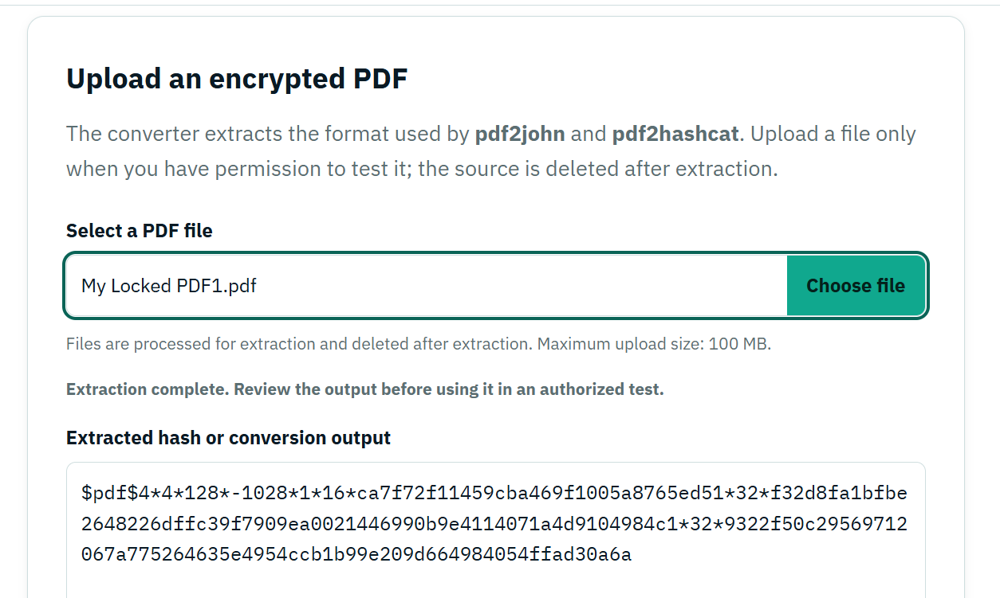
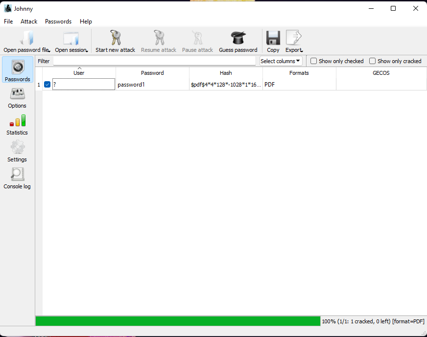
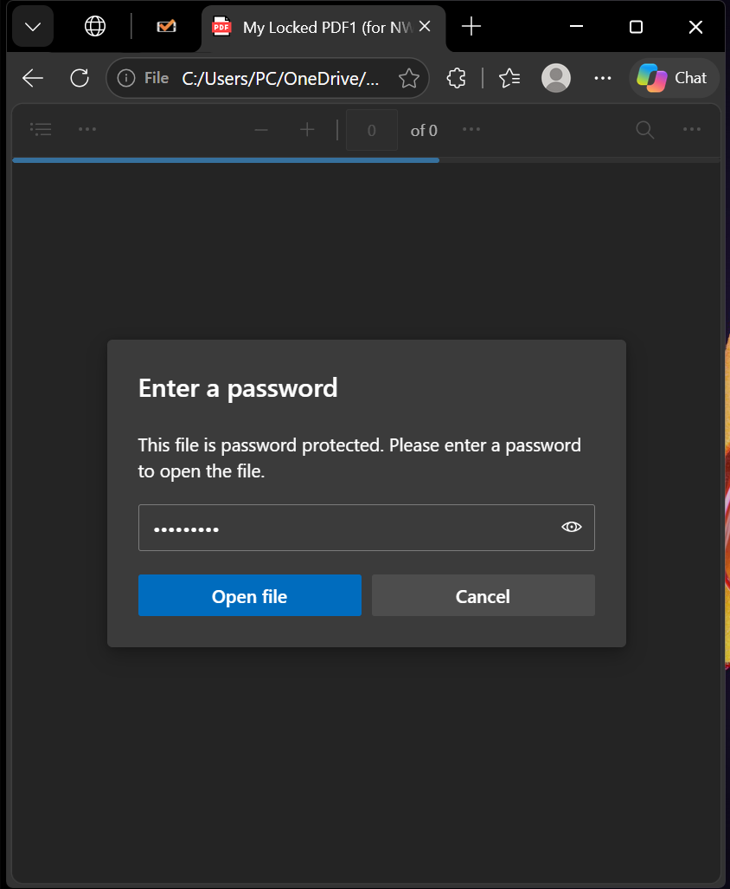
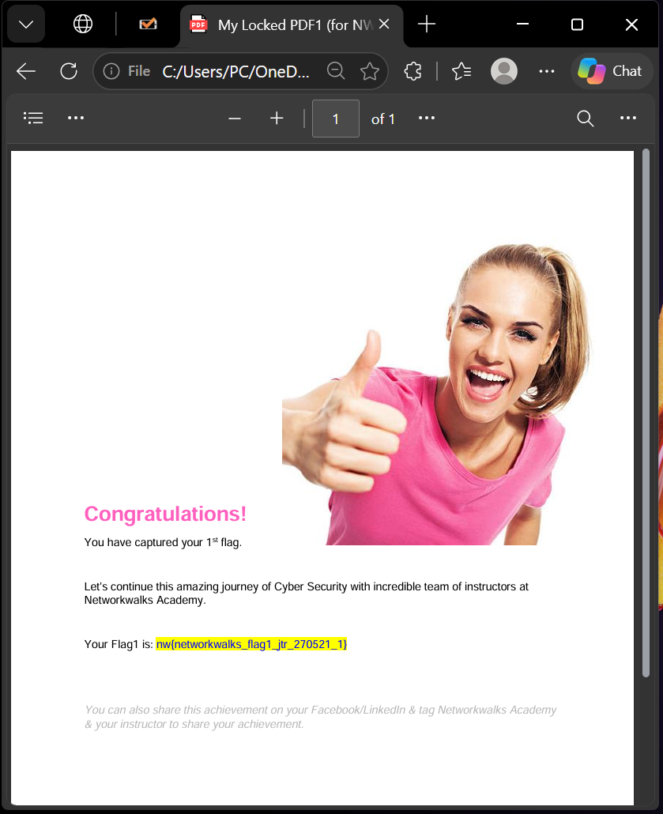

**W3-PM2: Networkwalks Tools**

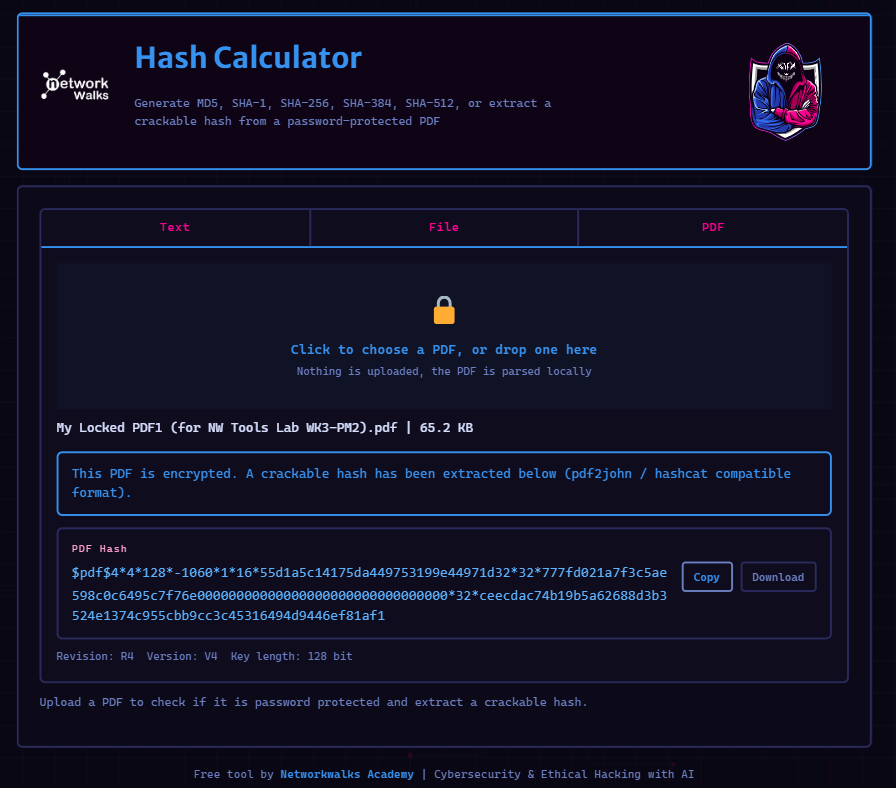
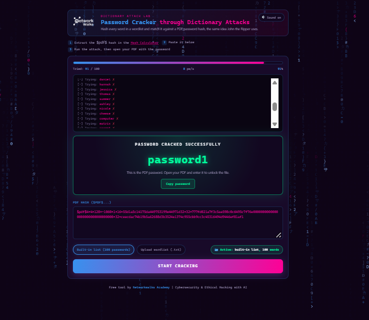
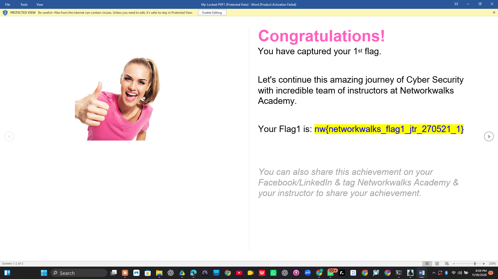

**Bonus practice files**

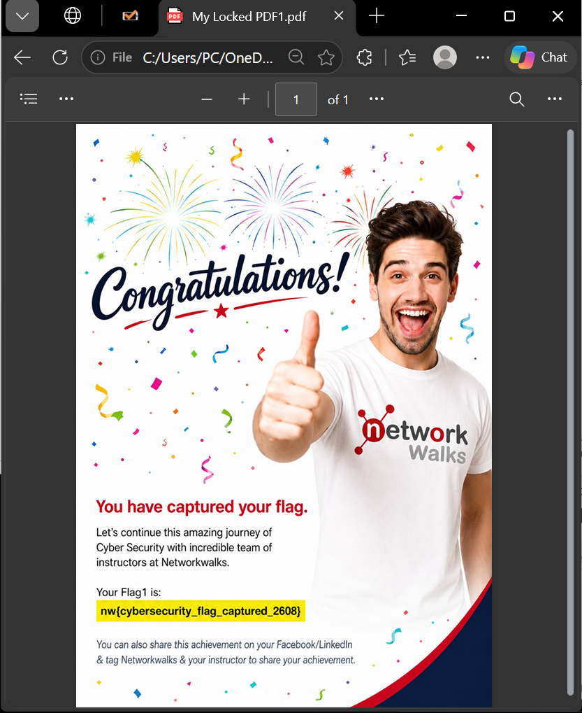
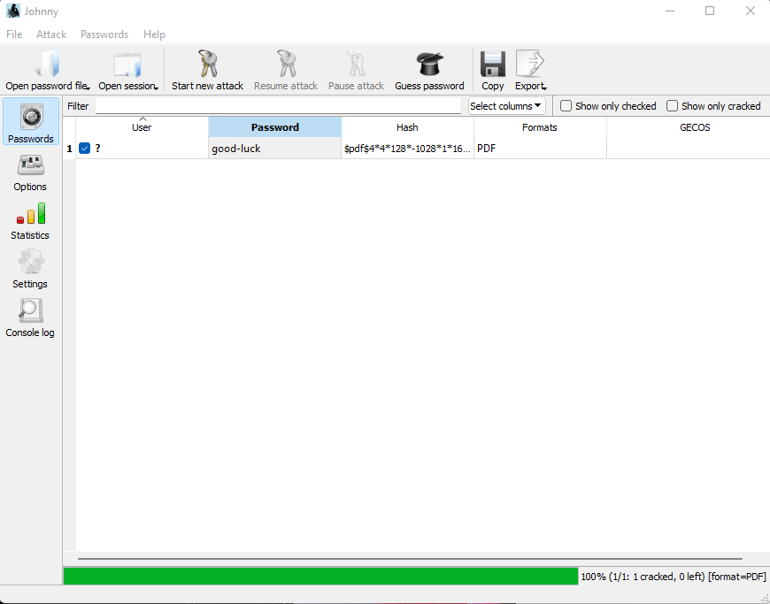
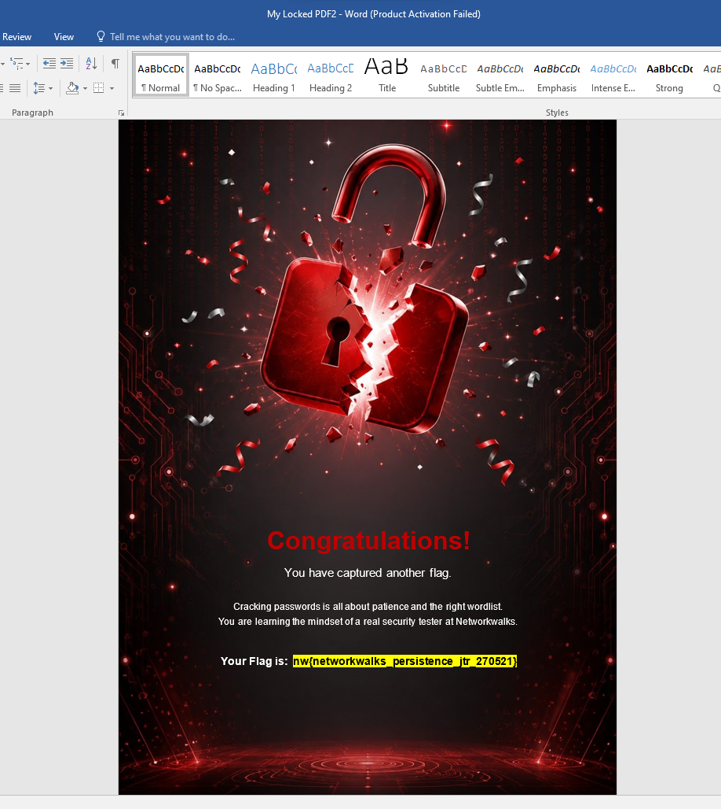
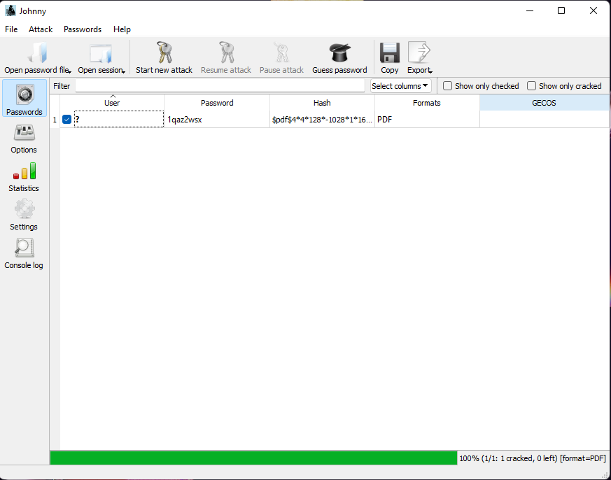
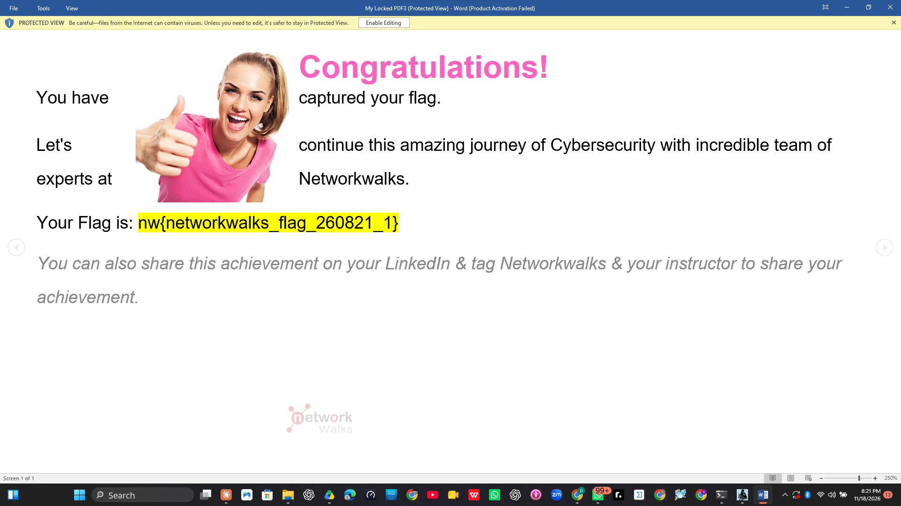

---

### Author

**Emmanuel Afunanya**

Cybersecurity Intern, Networkwalks B084

LinkedIn: https://www.linkedin.com/in/emmanuel-afunanya-730ba9207

GitHub: https://github.com/Emmanuel-DeEthical

Pentesting Project Report | Networkwalks
